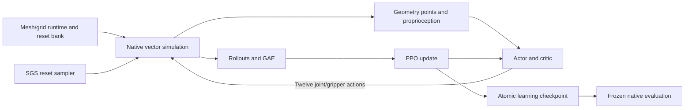

# Repository structure and proposed organization

**Goal:** Explain ownership boundaries so the Oracle bug hunt can run now and later refactoring remains small.

The original working directory contains three independent projects: the historical `robotics_ml` research wrapper, the fresh `projects/assemble_so101` training fork, and `/home/alessandro/feather-teleop` for Quest control. They are not a single portable package. This private repository copies the reviewed training fork and adds its operational handoff. It excludes the historical research archive and now includes the simulation-only Quest app in `teleop/`. The canonical physical factory/configuration lives here; the repository-owned Quest adapter calls it directly. Training and Quest use separate instances of the same native model.

| Layer | Current location | Input → output |
| --- | --- | --- |
| Geometry/contact | `configs/so101_scene.json`, `so101/workcell.py`, `scene.py`, `collision.py`, `tool.py`, `plugin/` | versioned physical configuration and pinned mesh/grid data → native MuJoCo model |
| Task/reset | `so101/env.py`, `resets.py`, `fastener.py` | reset states and twelve actions → observations/reward/done/diagnostics |
| Vector execution | `rl/vecenv.py`, `remote.py`, optional `so101/warp_env.py` | sampled states and actor actions → batched transitions |
| Learning | `train.py`, `rl/nets.py`, `sampler.py` | transitions → GAE/PPO updates, SGS history and checkpoints |
| Quest teleop | `teleop/` | controller input and native poses → simulated arm commands, local HTTP/cameras and head-tracked stereo |
| Operations | `scripts/cloud/`, `configs/` | verified runtime and explicit budgets → preflight, bounded job, logs/report |
| Independent assessment | `so101/evaluate.py` and existing check scripts | frozen policy → task/safety outcomes, separate from TRAIN success |

## Better organization, staged

1. **Selected now:** retain package paths and add `configs/`, `scripts/cloud/`, `tests/`, and current handoff docs. This avoids invalidating reset signatures, checkpoints and import paths before Nikita's first run.
2. **Next refactor:** separate task definitions from robot descriptions and physics execution under `robots/`, `tasks/hiwonder_base/`, `physics/`, and `learning/`. Move one boundary at a time, with matched observations/rewards/reset and checkpoint comparisons. The current `workcell.py`/JSON contract centralizes the live physical scene; the teleop adapter contains only controller/render metadata. Configuration edits require a rebuild/reload, preserving running experiments.
3. **Alternative:** move everything into a monorepo including Quest and old research. It improves cross-project visibility but introduces unrelated dependencies and much larger histories. Keep historical experiments as referenced archives instead.

The present Python package name remains `assembly_policy`; renaming it to match the GitHub repo adds migration work without helping the first learner test. Native CPU physics plus a single CUDA learner is the supported handoff path. Existing upstream distributed execution and the optional GPU-physics research backend remain in source; neither multi-node Oracle deployment nor multi-GPU learning is qualified here.

Training and `teleop/` use `scene.model` and `robot.home` from this checkout. `workcell.py` applies canonical contact surfaces/pairs, solver/search budgets, mounts/cameras and free-body damping. The version-pinned native contact adapter loads through the factory, including worker processes; no Feather preload is needed. The compiled option reserves50SDFcontacts, while per-model numerics select4/10search or40/40for the motor/base volume pair. This separates capacity from search work without changing shared options during collisions.

Reset signatures bind normalized XML, initialization/damping, assets and native contact source; training saves this signature and Quest exposes it in `/api/config`. Old bank/checkpoint resumes fail explicitly. A regression compares full serialized native models from the real training and Quest entrypoints byte for byte, plus initialized positions/controls. A versioned numeric reference provides a separate regression baseline. See [current environment](CURRENT_ENVIRONMENT.md) for failed fit tests and calibration limits.
